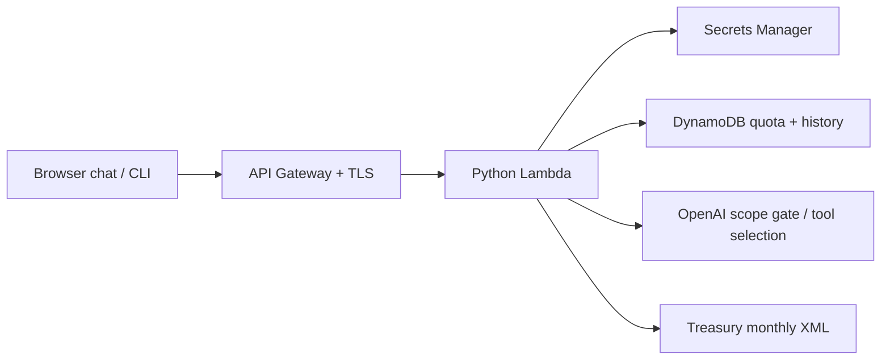

# AskBrieves

A small agentic service that answers questions about **latest and dated U.S. Treasury par yields**, with bounded behavior, repeatable deployment, and clear operational tradeoffs.

The design puts a flexible language interface around a small set of verifiable operations. OpenAI interprets the question; application code decides which operations are allowed, retrieves the evidence, calculates the result, and saves the answer. The [design choices](#design-choices-and-tradeoffs) explain why those boundaries matter.

## Run the service

### Use the hosted chat

1. Open **https://askbrieves.brianjeanbuilds.com**.
2. Select **Access** and enter the reviewer bearer token supplied privately by Brian. Ask for a fresh token if access has expired. No AWS account or OpenAI key is needed to use this deployment.
3. Ask a question such as “What was the 10-year Treasury yield on October 23, 2025?” or “Is the yield curve inverted?” Use **History** to retrieve saved questions and answers.

The bearer token authorizes this service; it is not the server's OpenAI API key. It stays in tab memory, without browser storage or cookies, so reconnect after refreshing. Changing credentials, disconnecting, or leaving the page clears the local transcript and draft; callbacks from an old session cannot repopulate them. A question typed before first connecting is preserved. Questions are independent: include the maturity and date in each question rather than relying on earlier messages. Reviewer history is separate from owner history; people sharing the reviewer token share that audience's history. New questions create new history entries.

The review has **1,000 total question attempts over one seven-day window**, shared by owner and reviewer access. There is no daily allowance or midnight reset: use the attempts whenever needed before the window closes. Refusals, missing-data results, and failed provider attempts count because they consume resources. Invalid requests, failed authentication, and history reads do not consume the question allowance.

The page, assets, and `GET /health` are public. Health reports that the handler is running; it does not check OpenAI, Treasury, secrets, or the database.

### Use the command-line client

Install Python 3.13+ and Git, then clone the repository. The client uses only the standard library; it needs no package installation or AWS credentials.

```bash
git clone https://github.com/jeanbrianc/askbrieves.git
cd askbrieves
python3 scripts/client.py "What's the 10-year Treasury yield?"
```

Enter the bearer token at the hidden prompt. The client contacts the hosted HTTPS service and prints the plain-language answer. More examples:

```bash
python3 scripts/client.py "Compare the 2-year and 10-year Treasury yields"
python3 scripts/client.py "What was the 10 year rate on October 23rd, 2025?"
python3 scripts/client.py "Compare the 10-year Treasury yield on 2025-10-23 with the latest yield"
python3 scripts/client.py "What is a basis point?"
python3 scripts/client.py "Is the yield curve inverted?"
python3 scripts/client.py --history
curl --fail https://askbrieves.brianjeanbuilds.com/health
```

For your own deployment, pass its endpoint explicitly: `python3 scripts/client.py --url https://askbrieves.your-domain.com "What is the 10-year Treasury yield?"`. Without `--url`, the client uses Brian's hosted service.

## Supported behavior and API

The API accepts `POST /questions`, JSON `{"question":"What's the 10-year Treasury yield?"}`, and `Authorization: Bearer <token>`. It returns JSON containing a plain-language `answer`, `status`, `request_id`, and source evidence for answered questions. `GET /history` returns the newest 20 records. Authentication failures are 401; malformed inputs 400; exhausted review quota 429 with code `review_limit_exceeded`; an inactive/expired question window is 403 with code `review_window_closed`; unavailable dependencies or invalid data are 503. Gateway burst throttles can also return 429 and require a short retry, while the total review quota has no daily reset. A deliberate scope refusal is 200 with `status: declined`. A supported date with no published observation or requested maturity is 200 with `status: no_data`; the service explains the gap without substituting another date or tenor.

Example answer shape (illustrative values, not a current quote):

> As of YYYY-MM-DD, the 10-year yield was X.XX%. These are daily U.S. Treasury par yields, not live quotes or deposit APYs. Source: [Treasury monthly table]

Supported maturities: 1, 2, 3, 4, 6 months; 1, 2, 3, 5, 7, 10, 20, 30 years. A question may request up to two maturities and two dates, including a comparison with the latest observation. Exact dates must be between `1990-01-02` and today's date in New York. A historical lookup requires that exact observation date: weekends, holidays, and maturities not published then return `no_data`. Latest lookups use the last published observation, at most seven calendar days old. Other rate products, future or ambiguous dates, predictions, investment advice, and unrelated or mixed requests are declined.

Single-date evidence contains `as_of`, `rates`, a readable Treasury monthly `source_url`, and the raw XML `data_url`. Two-date evidence contains an `observations` list with that same evidence structure for each date. Dates and numeric values are formatted by the application from the verified source data.

## Request flow



1. Authenticate, validate a body of at most 4 KiB and a question of at most 500 characters, check the seven-day question window, atomically claim one of its 1,000 attempts, and save a pending history entry.
2. Make **one** OpenAI Responses API call. Strict function schemas offer rate lookup, a reviewed concept explanation, a fixed 2-year/10-year curve assessment, or decline. The model reviews the entire question and chooses an action. Python independently validates tool count, names, fields, topic/maturity enums, and date bounds.
3. Execute the fixed Treasury adapter with at most three monthly downloads per request: two requested months and, if needed, a previous-month fallback for latest. Latest observations must be no more than seven calendar days old and never in the future. Historical lookups select the exact requested row, with no weekend or holiday substitution. Missing observations or tenors return `no_data`; invalid source data fails closed. Each comparison uses the requested maturities from the same dated row.
4. Format the answer and any basis-point spread in Python, then persist the result **before** returning it. The model supplies neither numeric rates nor arbitrary final prose.

The service also explains basis points, Treasury yields, yield curves, inversion, spreads, yield versus APY, and federal-funds versus Treasury rates. These are fixed, reviewed explanations with official references, not model-written advice. Curve assessments calculate the 2-year/10-year segment from verified observations; they do not forecast recessions or describe every point on the curve. Current Fed policy-rate quotes remain outside the data scope.

## Design choices and tradeoffs

### Use a model for language understanding, keep authority in code

People ask for the same observation in different ways: “10-year rate,” “Treasury yield,” or a comparison with a named historical date. One OpenAI Responses call translates that language into a small, structured decision. This gives the interface useful flexibility while keeping the execution path inspectable. Strict tool schemas are backed by independent Python validation; the model cannot read history, access AWS resources, fetch a submitted URL, or execute code.

Quoted yields and calculated spreads come from validated source observations and decimal arithmetic. Educational answers come from seven reviewed definitions with official citations. A second model call to write the answer would add latency, cost, and another opportunity to invent information without improving these narrow responses. An agent loop or vector database would add state and operations that this task does not need.

The accepted limitation is semantic accuracy: the model can still select the wrong allowed maturity, date, or topic. Source grounding prevents invented rates; it does not prove that the question was understood correctly. Each successful rate lookup exposes its observation date and evidence so that interpretation can be checked. A larger policy evaluation dataset would be the next investment before broadening the tools.

Each question is sent to OpenAI using the server-side project key. Earlier chat messages are not forwarded. Standalone questions keep input size and privacy exposure predictable, at the cost of conversational follow-ups such as “what about last year?” needing a complete question.

### Prefer an authoritative, narrow data source over broad coverage

Treasury publishes the exact daily nominal par-yield series used by the service, without a second provider credential or a data subscription. Fetching its structured XML avoids scraping a presentation page; the chat links to the readable monthly table, while API evidence also retains the raw feed URL. [Feed documentation](https://home.treasury.gov/treasury-daily-interest-rate-xml-feed), [methodology](https://home.treasury.gov/policy-issues/financing-the-government/interest-rate-statistics/interest-rates-frequently-asked-questions).

Historical questions require an exact published row. Silently substituting Friday for a requested Saturday would produce a plausible answer to a different question. Latest observations instead have a seven-calendar-day freshness allowance to accommodate publication gaps, with stale or future observations rejected. Two maturities from one date use the same row, and comparisons preserve both dates.

This deliberately limits coverage to daily Treasury par yields rather than live prices, bank APYs, mortgages, or Fed policy-rate values. The service depends on Treasury's availability and may return `no_data` or 503. Returning an explicit gap is preferable to substituting a different product, date, or unverified value. A cache could reduce repeated downloads, but would need equally explicit provenance, freshness, and invalidation rules.

### Use Python and serverless infrastructure to keep operations small

The workload is a short HTTP request followed by bounded API calls and a database write. Python's standard library covers the HTTP, JSON, XML, and decimal work. Lambda plus API Gateway supplies managed execution, routing, TLS, and throttling without an always-running container or server to patch. Pure-Python packaging works on an M1 Mac without Docker or cross-compilation.

The tradeoffs are AWS dependence, cold starts, and a synchronous dependency chain. Lambda has a 28-second timeout; slow provider calls can exhaust it. Automatic provider retries are omitted so that latency and paid attempts remain bounded. A timeout can leave a pending record, and a client retry is a new attempt. There is no exactly-once guarantee.

The function uses Lambda's provided boto3. That keeps the deployment small but accepts runtime SDK updates; the development requirements pin direct dependencies, not a complete transitive lock. Bundling a pinned runtime SDK and locking the dependency graph would be appropriate if stronger reproducibility became a requirement.

### Match DynamoDB to the access patterns, make persistence part of success

The service needs three operations: record/update a request, query recent audience history, and atomically increment a review-window counter. DynamoDB supports those operations without a relational schema, connection pool, or capacity planning in on-demand mode. Conditional writes enforce one global allowance even when requests arrive concurrently. Every request in the configured seven-day window uses the same counter, including across midnight; ordinary code deployments preserve the deadline and counter. Counter TTL is after the window ends, so it cannot expire and reopen the allowance while access is active.

A pending history record is written before model work, and the completed answer must be persisted before a successful response is returned. That makes persistence a condition of a successful API response. The cost is availability: a history-store failure prevents a successful answer even if the provider returned usable data. Failed and declined attempts consume quota because they still use resources.

History has a 30-day visibility window and TTL, encryption, point-in-time recovery, and retention on stack deletion. These choices favor recovery and traceability, while accepting storage costs and cleanup work. TTL deletion is asynchronous and backups can retain older data; this is not a statutory deletion guarantee. History retrieval returns the newest 20 records, without pagination or an analytics interface.

### Separate demo access from provider credentials, limit runtime permissions

A generated owner bearer credential and an optional expiring reviewer credential are sufficient for a small, privately shared demo. Fixed history partitions keep reviewer traffic separate from owner traffic without introducing an identity platform. The OpenAI key stays in a different Secrets Manager secret and never belongs in a browser or client command. Runtime IAM names only the two required secrets, one table, and the function log group. A 60-second secret cache reduces repeated reads while allowing rotation to take effect shortly afterward.

This is audience isolation, not individual user or tenant isolation. Reviewers sharing a credential share their history and the 1,000-attempt review allowance. Use a generated random reviewer token with an expiry at or before the question-window deadline and distribute it privately. Production multi-client access would require per-client identity, authorization, revocation, and quotas. The review attempt cap limits model use; it does not cap AWS charges from public traffic. Gateway throttling applies per route and is best effort; the function uses shared account concurrency by default rather than requiring a new capacity reservation.

### Make infrastructure and releases explicit

CloudFormation keeps the deployed resources and their configuration reviewable in two templates, with state managed by AWS. A separate bootstrap stack owns the private, encrypted, versioned artifact bucket; the service stack owns the API, function, history, generated API-access secret, DNS/TLS, and alarms. The OpenAI key secret is supplied externally. Keeping release artifacts outside the service stack makes code replacement and rollback easier to reason about.

Packages use deterministic contents and SHA-256-addressed S3 keys. A previous artifact key provides a concrete rollback target; bucket versioning does not make a key write-once. CI runs tests, template lint, and packaging with no AWS credentials or deployment permission. A human invokes deployment, preserving an explicit infrastructure-change boundary at the cost of a manual release step.

Retaining state across stack deletion avoids accidental loss of history and credentials, but means teardown is not complete until retained resources are reviewed. Three alarms expose API errors, Lambda errors, and throttles. They have no paging destination yet; that is a visible operational gap, not an automated on-call capability. The [runbook](docs/operations.md) covers diagnosis, rotation, a kill switch, rollback, and retained-resource cleanup.

### Keep the chat as a thin client of the API

Plain HTML, JavaScript, and CSS provide a usable chat without a frontend framework, build pipeline, external assets, or analytics. Serving them from the same Lambda keeps browser requests on the same origin and reuses the API's authentication and scope controls. Text rendering and a restrictive Content Security Policy reduce browser execution paths.

The accepted cost is that public asset requests also invoke Lambda, and the page offers only a small chat/history interface. Tokens stay in memory, so refreshing requires reconnecting. A static CDN frontend and full sign-in flow would be reasonable once traffic or identity requirements justify operating them.

## Guardrails and limits

| Control | Implementation and boundary |
|---|---|
| Access | Generated 48-character owner credential; optional expiring reviewer credential. Constant-time comparison and HTTPS. Reviewers cannot choose or read the owner's history partition. Reviewer access is a temporary demo convenience, not a production identity system. |
| Agent authority | One model call; schema-constrained lookup, explanation, curve assessment or decline; no generic tools; local validation; fixed numeric/prose output path. Scope classification is probabilistic, not a formal guarantee. |
| Data integrity | Fixed Treasury host/path, redirects disabled, XML DTD/entities rejected, 1 MiB source cap, locally validated dates, exact historical observations, freshness checks for latest, decimal arithmetic. Missing data is reported explicitly; no invented fallback rates. |
| Cost containment | Per-route API target 1 request/second, burst 2; global atomic allowance of 1,000 attempts total over seven days, with no daily reset; one model call with 256 output tokens; at most three monthly source downloads; no automatic provider retry. Lambda shares existing account concurrency capacity by default. Refusals, no-data results, and failed attempts consume quota. Gateway throttling is best effort; this is not a hard dollar cap. |
| Secrets / IAM | Secret ARNs in config, values fetched only by runtime, 60-second cache. Function permissions name its two secrets, its one table, and its log group. No trading, account access, or general AWS authority. |
| History / privacy | Accepted questions, decisions, and answers retained for 30 days; query hides expired history even before asynchronous TTL deletion. No prompts, answers, tokens, IPs, or provider bodies in application/access logs; log retention 14 days. Do not submit PII or credentials. Obvious API/AWS key patterns are rejected, not comprehensive PII detection. |
| Fail closed | Auth, model, source, quota-store, or history-store errors cannot produce a successful rate answer. A crash/timeout can leave a pending history entry; retries are new attempts, with no exactly-once promise. |

This demonstrates security and audit controls; it does **not** assert SOC 2, SOC 1, or regulatory compliance. OpenAI receives the submitted question and fixed policy, with `store: false`; this disables stored Responses state, not all provider retention. Review the project's data controls before sending sensitive data. A ChatGPT subscription does not supply API credits; the dedicated OpenAI project key requires API billing. [OpenAI data controls](https://developers.openai.com/api/docs/guides/your-data), [function calling](https://developers.openai.com/api/docs/guides/function-calling).

## Verify locally

From the cloned repository, use Python 3.13+ (for example, `python3.13` on macOS) to create an isolated environment. Install Node.js 22+ for the offline browser-session tests; they use Node's built-in test runner, with no npm packages or frontend build step.

```bash
python3.13 -m venv .venv
source .venv/bin/activate
python -m pip install -r requirements-dev.txt
python -m pytest -q
node --test tests/web_session.test.cjs
cfn-lint infra/bootstrap.json infra/service.json
python scripts/package.py
```

After dependency installation, these checks run offline with mocked AWS, OpenAI, and Treasury boundaries. The JavaScript tests execute the actual chat script against a minimal synthetic DOM and deferred fetch responses, including credential changes, disconnects, empty history, and stale callbacks. They are not a full browser-engine compatibility test. All offline checks need no credentials and do not change deployed history. Packaging writes `build/askbrieves.zip` and `build/sha256.txt`. CI repeats the test/lint/package path on Python 3.13 and Node.js 22.

Tests cover valid lookups and comparisons as well as malformed tools, prompt/scope boundaries, authentication and expiry, audience isolation, atomic quota behavior, unsafe XML, missing dates, stale/future data, persistence failures, and browser rendering contracts. Mocks establish code behavior; they do not prove provider availability or live-model policy compliance.

There is no local HTTP server or AWS emulator included. The CLI talks to an HTTPS deployment; local development verification exercises the handler through tests.

## Deploy into your AWS account

### Prerequisites and credentials

Use the environment above, AWS CLI v2, and an authenticated deployment profile authorized to manage the resources declared in `infra/`, including the IAM role. You also need:

- A dedicated OpenAI project key with API billing, saved privately in a **same-region** Secrets Manager secret as JSON with an `api_key` field. Create it in the provider/AWS consoles; pass only its ARN to deployment. The template assumes the AWS-managed Secrets Manager encryption key; customer-managed KMS keys need additional scoped decrypt permission.
- A public Route 53 hosted zone and an unused hostname inside it. ACM uses that zone for DNS validation. The existing instance is in `us-east-1`; the example below also uses that region.

These are three distinct credentials: AWS credentials deploy infrastructure, the OpenAI project key authorizes server-side model calls, and the generated service bearer token authorizes chat/API clients. A reviewer token for the hosted service grants no AWS deployment access.

### Provision and deploy

Replace the placeholders with your secret ARN, zone ID, and hostname. Use a separate stack name when deploying alongside an existing instance.

```bash
# Authenticate the AWS CLI using your normal SSO/profile workflow first.
AWS_PROFILE=your-profile ASKBRIEVES_STACK=askbrieves-alex \
  bash scripts/deploy.sh us-east-1 \
  'arn:aws:secretsmanager:us-east-1:YOUR_ACCOUNT:secret:YOUR_SECRET' \
  'YOUR_HOSTED_ZONE_ID' askbrieves.your-domain.com
```

The script tests/lints, packages, deploys `<stack>-artifacts`, uploads the package under its SHA-256, and deploys `<stack>` with `CAPABILITY_IAM`. It **executes infrastructure changes immediately**; it does not pause for change-set approval. Inspect both templates before running it. Where change-set approval is required, create, inspect, and execute the CloudFormation changes explicitly instead of treating this script as a preview.

The service stack prints `Endpoint`, `ApiAccessSecretArn`, and operational resource outputs. In Secrets Manager, open the generated API-access secret privately and use its `token` field to connect to your endpoint. The deployment creates TLS 1.2 minimum, IPv4/IPv6 DNS aliases, and disables the default execute-api endpoint when a custom domain is configured. For a default deployment, omitting `ASKBRIEVES_STACK` selects `askbrieves`.

`RequestLimit` defaults to 1,000 (configurable from 1 to 1,000), and `ReviewWindowEndsAt` is the UTC epoch second at the end of a fixed seven-day window. On a new stack, the release script chooses an end seven days from deployment; on an update it preserves the existing end and limit, even if the window has expired. A direct CloudFormation deployment must supply `ReviewWindowEndsAt` explicitly. To intentionally open a fresh review window, set `ASKBRIEVES_REVIEW_WINDOW_ENDS_AT` to the desired end epoch before invoking the script; `ASKBRIEVES_REQUEST_LIMIT` can explicitly set its limit. Changing the deadline identifies a new allowance, so it is an operator action, never an automatic renewal or client-selected field. See [operations](docs/operations.md) for activation and audit-preservation steps.

The default `ReservedConcurrency=-1` omits a Lambda reservation and shares existing account capacity. The script does not request a quota increase. An optional positive `ASKBRIEVES_RESERVED_CONCURRENCY` setting reserves and limits function capacity when the regional account has enough available; the API throttle and review request cap apply in either mode.

Optional reviewer access uses `reviewer_token` and integer UTC epoch `reviewer_expires_at` fields in the same secret, preserving the existing owner `token`. Align that expiry with or before `ReviewWindowEndsAt`; both authentication and the model-request window must permit a question. Reviewer tokens accept 12–512 characters; owner tokens remain 20–512 characters. Generate reviewer values with at least 32 random bytes (for example, a 43-character URL-safe encoding), rather than choosing a memorable phrase. Distribute values privately, never through this public repository. Both audiences share the review allowance.

### Verify your deployment

Open the printed endpoint and connect with its service token, or run the client with `--url` and its hidden token prompt. For the extended real-provider acceptance suite, the following prompts without putting a token literal in shell history:

```bash
ASKBRIEVES_URL=https://askbrieves.your-domain.com python - <<'PY'
import getpass
import os
import subprocess
import sys

os.environ["ASKBRIEVES_TOKEN"] = getpass.getpass("AskBrieves bearer token: ")
subprocess.run([sys.executable, "scripts/smoke.py"], check=True)
PY
```

The baseline suite requires working AWS/provider configuration behind the endpoint, uses real OpenAI/Treasury calls, consumes **11 review-window attempts**, and writes **11 synthetic history entries**. `ASKBRIEVES_URL` is required for another deployment; otherwise the suite targets Brian's hosted service. A passing health check alone does not establish these dependencies are working.

For the additional seven explanations, latest/historical curve assessments, dated changes, refusals, and owner/reviewer isolation, run the optional extended suite with two distinct credentials:

```bash
ASKBRIEVES_URL=https://askbrieves.your-domain.com python - <<'PY'
import getpass
import os
import subprocess
import sys

os.environ["ASKBRIEVES_TOKEN"] = getpass.getpass("Owner bearer token: ")
os.environ["ASKBRIEVES_REVIEWER_TOKEN"] = getpass.getpass("Test reviewer bearer token: ")
subprocess.run([sys.executable, "scripts/smoke_review.py"], check=True)
PY
```

The extended suite adds **13 review-window attempts and 13 reviewer history records**; it does not rerun the baseline or delete history. It requires a nonempty owner history so the isolation check has real evidence; run the baseline first on a fresh deployment. Both suites together consume 24 attempts. Use a separate validation window and private test credentials, then explicitly activate the reviewer's fresh seven-day window and clean up reviewer test history before handoff. Old counters remain for audit; cleanup does not erase consumed usage. See the [review-window verification](docs/verification-review-window.md) for current activation evidence and [handoff verification](docs/verification-handoff.md) for the preceding session fix.

See [operations](docs/operations.md) before changing quotas or credentials, stopping the function, rolling back an artifact, or deleting stacks. Retained data, secrets, artifacts, and DNS validation records require explicit cleanup after stack deletion.

## Evidence, costs, and next steps

The [reviewer capability verification](docs/verification-reviewer.md), [historical release proof](docs/verification-historical.md), and [initial deployment evidence](docs/verification.md) record dated tests, artifact digests, deployment readbacks, and sanitized request/log evidence. The reviewer release includes an offline Codex Security assessment with its scope and limitations. These are recorded observations, not a promise that an endpoint, credential, or dependency remains healthy today.

Costs come from API/Lambda requests, DynamoDB requests/storage/PITR, two Secrets Manager secrets, logs, alarms, artifacts, and DNS. There is no NAT gateway, VPC, load balancer, container host, or database instance. The pinned model is `gpt-5.4-mini-2026-03-17`, with reasoning disabled for this small classification task. Review [current model pricing](https://developers.openai.com/api/docs/models/gpt-5.4-mini) and AWS pricing before raising the quota. OpenAI spend alerts do not stop traffic; an enforced hard spend limit on a dedicated project can stop affected model requests after tracked spend reaches the limit, with a possible small propagation overshoot. Confirm that setting separately in the provider console; this CloudFormation deployment does not configure it. [OpenAI spend limits](https://developers.openai.com/api/docs/guides/spend-limits). Neither provider controls nor the model quota cap AWS charges from unauthenticated traffic.

The next investments follow the current limits: per-client identity and quotas for isolation, an appropriate edge abuse control for public traffic, owned paging and measured availability/latency objectives for operations, and a larger model-policy evaluation dataset before expanding scope. A cache or static CDN should follow observed source load or asset traffic. Multi-region infrastructure would add complexity before there is a demonstrated recovery or availability requirement.
