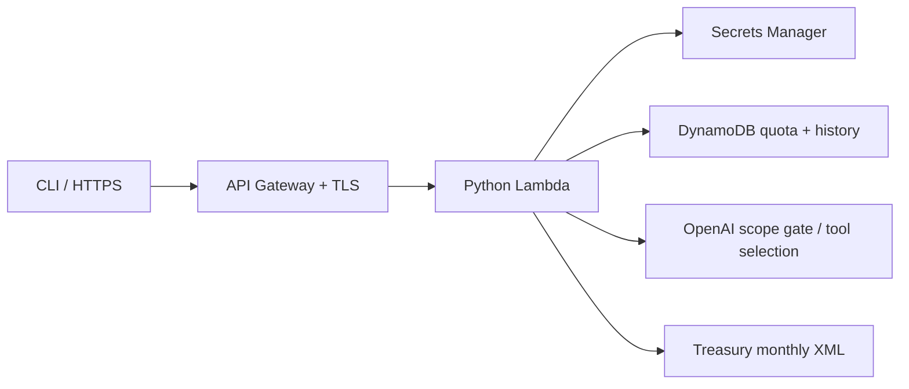

# AskBrieves

A small agentic service that answers questions about **latest published U.S. Treasury par yields**. Built for the ModernFi platform engineering take-home, with the emphasis on bounded behavior, repeatable deployment, and clear operational tradeoffs.

Endpoint: **https://askbrieves.brianjeanbuilds.com**. `GET /health` is public; questions and history require the demo bearer token. Deployment evidence is recorded in [docs/verification.md](docs/verification.md).

## Try it

Python 3.13+ is sufficient for the client; no packages are required. Ask Brian for the demo token through a private channel. The client prompts without echoing it, so it does not enter shell history.

```bash
python3 scripts/client.py "What's the 10-year Treasury yield?"
python3 scripts/client.py "Compare the 2-year and 10-year Treasury yields"
python3 scripts/client.py --history
curl --fail https://askbrieves.brianjeanbuilds.com/health
```

The API accepts `POST /questions`, JSON `{"question":"What's the 10-year Treasury yield?"}`, and `Authorization: Bearer <token>`. It returns JSON containing a plain-language `answer`, `status`, `request_id`, and source evidence for answered questions. `GET /history` returns the newest 20 records. Authentication failures are 401; malformed inputs 400; exhausted daily quota 429; unavailable dependencies or unverifiable data 503. A deliberate scope refusal is 200 with `status: declined` and a fixed explanation.

Example answer shape (illustrative values, not a current quote):

> As of YYYY-MM-DD, the 10-year yield was X.XX%. These are daily U.S. Treasury par yields, not live quotes or deposit APYs. Source: [dated Treasury XML feed]

Supported maturities: 1, 2, 3, 4, 6 months; 1, 2, 3, 5, 7, 10, 20, 30 years. A question may request one yield or compare two. Other products, historical dates, predictions, investment advice, ambiguous questions, and unrelated or mixed requests are declined. This scope keeps the data semantics explicit instead of substituting a Treasury yield for a mortgage or deposit rate.

## How it works and why



1. Authenticate, validate a body of at most 4 KiB and a question of at most 500 characters, atomically claim one of 100 daily attempts, and save a pending history entry.
2. Make **one** OpenAI Responses API call. A strict function schema offers only `lookup_treasury_yields` and `decline_question`. The model reviews the entire question and chooses an action. Python independently validates the result, including tool count, names, fields, and maturity enums.
3. For an allowed lookup, execute the fixed Treasury adapter. Select the latest dated row, require all requested yields from that same row, reject missing or invalid values, and reject observations more than seven calendar days old or in the future. At a month boundary, an empty current month permits a previous-month fetch. Weekends therefore show the last published observation with its date.
4. Format the answer and any basis-point spread in Python, then persist the result **before** returning it. The model supplies neither numeric rates nor arbitrary final prose.

This is a constrained, single-step tool-using agent. An open-ended loop, vector database, multi-agent framework, and a second LLM answer-writing call add little value here. The final answer is grounded by construction, even if the probabilistic scope gate makes a mistake. The model cannot read history, retrieve AWS resources, browse a submitted URL, or execute code.

**Python + Lambda + HTTP API:** few moving parts, no server patching or idle container fleet, and native request throttling and TLS. The runtime uses the standard library and Lambda's provided boto3; no compiled packages or Docker are needed on an M1 Mac. We accept AWS's runtime SDK updates for this small service; package and pin boto3 if stronger dependency reproducibility becomes necessary.

**DynamoDB:** the access patterns are append/update a request, list recent history, and increment an atomic daily counter. There are no joins or business transactions requiring PostgreSQL. On-demand billing avoids capacity tuning for an interview demo. The table is encrypted, has point-in-time recovery, and is retained when the stack is deleted.

**Plain CloudFormation:** explicit, reviewable AWS resources without another IaC state service or framework dependency. Pulumi would be reasonable in an existing Pulumi estate; this isolated service does not need a new toolchain. A separate bootstrap stack owns private artifact storage, and immutable SHA-256 package keys make rollback straightforward. Deployment is a human-invoked action; CI validates but has no AWS credentials or deployment permission.

**Treasury directly:** an authoritative public source with no extra data-provider key. These are nominal daily par constant-maturity yields, not intraday executable quotes, a bond price, or deposit APY. [Treasury feed documentation](https://home.treasury.gov/treasury-daily-interest-rate-xml-feed) and [methodology](https://home.treasury.gov/policy-issues/financing-the-government/interest-rate-statistics/interest-rates-frequently-asked-questions).

## Guardrails and limits

| Control | Implementation and boundary |
|---|---|
| Access | Generated 48-character bearer secret, constant-time comparison, HTTPS only. One shared demo audience; holders can read all demo history. No tenant isolation claim. |
| Agent authority | One model call; two schema-constrained actions; no generic tools; local validation; fixed numeric/prose output path. Scope classification is probabilistic, not a formal guarantee. |
| Data integrity | Fixed Treasury host/path, redirects disabled, XML DTD/entities rejected, 1 MiB source cap, dated/freshness-checked observations, decimal arithmetic. No invented fallback rates. |
| Cost containment | API target 1 request/second, burst 2; default Lambda reservation 2; global atomic 100 attempts per UTC day; 256 output tokens per call; no automatic provider retry. An explicit optional setting can omit the reservation and share account capacity instead. Refusals and failed attempts consume quota. Gateway throttling is best effort; this is not a hard dollar cap. |
| Secrets / IAM | Secret ARNs in config, values fetched only by runtime, 60-second cache. Function permissions name its two secrets, its one table, and its log group. No trading, account access, or general AWS authority. |
| History / privacy | Accepted questions, decisions, and answers retained for 30 days; query hides expired history even before asynchronous TTL deletion. No prompts, answers, tokens, IPs, or provider bodies in application/access logs; log retention 14 days. Do not submit PII or credentials. Obvious API/AWS key patterns are rejected, not comprehensive PII detection. |
| Fail closed | Auth, model, source, quota-store, or history-store errors cannot produce a successful rate answer. A crash/timeout can leave a pending history entry; retries are new attempts, with no exactly-once promise. |

This demonstrates security and audit controls; it does **not** assert SOC 2, SOC 1, or regulatory compliance. OpenAI receives the submitted question and fixed policy, with `store: false`; this disables stored Responses state, not all provider retention. Review the project's data controls before sending sensitive data. A ChatGPT subscription does not supply API credits; the dedicated OpenAI project key requires API billing. [OpenAI data controls](https://developers.openai.com/api/docs/guides/your-data), [function calling](https://developers.openai.com/api/docs/guides/function-calling).

## Run tests and deploy

Prerequisites: Python 3.13+, AWS CLI v2, an AWS deployment identity able to manage the resources in `infra/`, a public Route 53 zone, and a **same-region** Secrets Manager secret with JSON field `api_key` containing a dedicated OpenAI project key. Create the key and secret privately in the provider/AWS consoles; never commit either value. The deployed instance uses `us-east-1`.

```bash
python3 -m venv .venv
source .venv/bin/activate
pip install -r requirements-dev.txt
python -m pytest -q
cfn-lint infra/bootstrap.json infra/service.json

# Authenticate the AWS CLI using your normal SSO/profile workflow first.
AWS_PROFILE=your-profile bash scripts/deploy.sh us-east-1 \
  'arn:aws:secretsmanager:us-east-1:YOUR_ACCOUNT:secret:YOUR_SECRET' \
  'YOUR_HOSTED_ZONE_ID' askbrieves.your-domain.com
```

The script tests/lints, packages, deploys `askbrieves-artifacts`, uploads an immutable artifact, then deploys `askbrieves` with `CAPABILITY_IAM`. Review the templates and CloudFormation change set when adapting this to another account. ACM creates its DNS validation record in the supplied zone. The custom domain has TLS 1.2 minimum and IPv4/IPv6 aliases; the default execute-api endpoint is disabled. For a disposable alternate stack, set `ASKBRIEVES_STACK=askbrieves-test` and use another domain.

The template defaults to `ReservedConcurrency=2`. The regional account quota must leave AWS's required unreserved pool available in addition to that reservation. An account limited to 10 total executions needs a quota of at least 12 to reserve two for this service. The preferred deployment retains the small function reservation. For a deliberate fallback on a low-quota account, prefix the deployment command with `ASKBRIEVES_RESERVED_CONCURRENCY=-1` to omit it. That shares existing account capacity without raising the account quota or guaranteeing capacity to this service. The 1 request/second target, burst of 2, and atomic 100-attempt daily cap still apply. Inspect the account and function quotas when adapting this deployment; the script never silently changes reservation policy.

Get the generated demo token privately from the stack's `ApiAccessSecretArn` output in the Secrets Manager console. Do not put the token in tickets, screenshots, commands, or deployment files. The client accepts a hidden prompt; CI tests mock dependencies. For a live acceptance test, inject `ASKBRIEVES_TOKEN` into the process securely and run `python scripts/smoke.py`. See [operations](docs/operations.md) for rotation, incident handling, rollback, and teardown.

## Operational choices and next steps

Costs come from API/Lambda requests, DynamoDB requests/storage/PITR, two Secrets Manager secrets, logs, alarms, artifacts, and DNS. There is no NAT gateway, VPC, load balancer, container host, or database instance. The pinned model is `gpt-5.4-mini-2026-03-17`, with reasoning disabled for this small classification task. Review [current model pricing](https://developers.openai.com/api/docs/models/gpt-5.4-mini) and AWS pricing before raising the quota. Project budget alerts are useful but are not an application spending cutoff; unauthenticated traffic can still incur AWS request costs.

For the 4–6 hour assignment, I prioritized deployability, explicit security boundaries, negative tests, and a usable runbook. Before a real multi-client rollout I would replace the shared token with per-client identities/history partitions, add WAF or an appropriate edge control and per-client quotas, connect alarms to an owned paging channel, define measured availability/latency SLOs, and add managed synthetic checks and a proper policy evaluation dataset. A multi-region system and an institutional compliance program are beyond this demo's scope.
